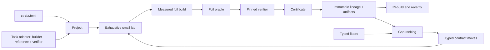

# Architecture and trust boundaries

`model` is format-neutral. `kickmix`, `trace` and the task adapter own circuit
access. `lab`, `engine`, `cost`, `store` and `queries` share the contract model.
`project` enforces gate order; the CLI delegates to that core.

A design's `architecture` is the contract-tree identity; the stored design
record identifies a concrete parameterized variant and its certificate. Several
variant records can share an architecture. Every parent record is retained.

A builder is not allowed to weaken the external reference, promise, phase rule,
failure rule or public register shape. It can alter internal clean workspace
and region layout. Changes outside declared patch regions fail before lab/build
promotion. Measurement debts remain explicit model objects; the current code
does not infer that an arbitrary untagged debt was repaid.

A price query verifies the requested constraint on an actual build. Conditional
executed cost needs a committed input distribution supplied by the adapter.
No estimate closes a scientific line; parked means retained with a reopen
condition. An exact-small rejection remains open at full size.

The store detects changed artifacts by SHA256 and uses SQLite transactions.
It is not an access-control service: trusted local Python code can access the
store API. Source hashes bind the adapter; dependency hashes and official
verifier identity are the adapter's explicit responsibility. Hashes alone do
not prove that a verifier statement is correct.

`Sandbox.run` is a separate offline subprocess API. It is never silently used
to execute trusted Python callbacks or substituted with an unsandboxed runner.
The read-only root mount is convenient for installed dependencies, but is not
secret isolation: run untrusted generators in a host/account without readable
secrets, or supply a narrower container policy. Network isolation alone does
not make malicious code harmless.

L3/L4 moves that change region names declare `replacement_regions` explicitly.
The old regions define the edited span; replacement regions define its new
implementation. The complete operations outside those spans must stay equal.
The lab reference returns phase as an exact `Fraction` in units of pi, modulo
two, matching kickmix. It never truncates fractional phase to an integer.
