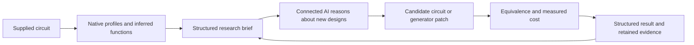

# Start with the supplied circuit

Understanding the circuit sufficiently to restructure it is a required core
feature. The project originally delivered experiment management before this
capability. File mode begins correcting that order; it does not declare the
full specification complete.

## What the connected agent receives



You provide a `.kmx` or `.kmb` file. A cost expression is optional. You do not
have to write a Python adapter, name the stages, or supply a desired rewrite.
The connected agent follows the repository skill and originates hypotheses
from the evidence. The standalone CLI does not secretly launch an AI model.

```bash
strata inspect-file circuit.kmb --out work/inspect
strata optimize circuit.kmb --out work/automatic \
  --cost 'Q*(toffoli+t/4)' --max-candidates 64
strata discover circuit.kmb --out work/research
strata evaluate-file circuit.kmb proposed.kmx --out work/research \
  --hypothesis idea.json
```

The first two commands work without a project file. `inspect-file` recovers
algebraic region contracts and profiles them. `optimize` uses one implemented
construction method: infer the complete region's output functions and sign
phase, then apply those effects directly instead of materializing and restoring
an intermediate value. The discovery commands support ideas beyond that built-in
construction; the connected AI supplies a candidate and the evaluator checks it.

## Automatic understanding currently implemented

For supported permutation and sign-phase operations, Strata constructs exact
Boolean polynomials for every touched output and for the phase exponent. Every
boundary wire is arbitrary, including apparent scratch. From those functions it
recognizes affine maps, bilinear/quadratic accumulator maps, sign-phase
polynomials and intermediate values that are computed, consumed and restored.

For example, it can infer that an intermediate's *initial dirty value* still
contributes to an output after its compute/use/uncompute sequence. The generated
replacement preserves that contribution; it cannot drop the dirty value by
assuming an undocumented zero. A source hash and the exact function accompany
each recovered contract.

Window budgets limit expression growth. Restored-intermediate witnesses help
choose episode boundaries within those budgets. Metadata is not semantic proof.
Unsupported operations and classical condition scopes remain opaque. Generic
algebraic coverage is reported separately from recovery of named arithmetic
stages such as a field inverse or the decoder's extraction recurrence.

## Native tools guide the search

Each file run creates `profile.json` and native kickmix views under `analysis/`:
flame SVG, bounded HTML diagrams, global reaction depth and the existing
conservative wire trace. Selected region diagrams show the actual instructions.
Region ranking combines measured paid operations, fixed-global-width objective
impact, intermediate materializations and boundary width. The optimizer's
candidate budget follows this ranking; it does not just walk from the first gate.

A reported removal ceiling asks what the static objective could lose if all
priced work in that region disappeared while global width stayed fixed. It is
not an achievable saving or a lower bound. Nonmonotone or nonadditive objectives
may have no such ceiling. Floors remain unknown unless backed by evidence.

The wire trace is heuristic/conservative, with initialization and conditional
limitations. It is not a proof that a data wire can be borrowed. Exact dynamic
allocation ownership, clean-wire leases, and information-rank slack remain
unimplemented. A graph explains evidence; its appearance does not prove it.

## Verification and retained evidence

The built-in optimizer only accepts replacements that reduce the chosen static
objective. It replays each disjoint changed region's complete input/output and
phase relation, checks untouched slices, and binds both artifact hashes. The
checker recomputes resources and costs rather than trusting reported success.
All possible dirty inputs are covered by canonical polynomial equality within
the supported model; this is not a Lean proof or an all-size generator theorem.

`candidate.kmx` is a separate artifact; the input stays unchanged. `result.json`
records measured resources, the chosen objective, accepted/deferred regions and
verification scope. The local `.strata` store retains content-addressed artifacts
and evidence. Passing file equivalence does not claim an official contest score,
validate the starting circuit against a task, or accept a chemistry factorization.
No command submits to a competition.

## Required work still outstanding

- Recover complete arithmetic stage architecture and wider producer-consumer
  contracts on the contest files, not only bounded algebraic episodes.
- Track HMR outcome ownership and phase-debt repayment through condition scopes.
- Understand approximate rotations and numerical co-design under the real error
  budgets; exact sign-phase checks do not cover arbitrary rotation changes.
- Recover or obtain parameterized models for meaningful small-size tests.
- Meet the original historical replay and new-design acceptance tests.

These are core acceptance obligations. Adding more reports or agent orchestration
alone does not satisfy them. The [independent review](FILE-FIRST-REVIEW.md)
describes what the current file workflow has actually established.
