# Strata 0.7 Latency Architecture

Algorithmic circuit discovery is bottlenecked by iteration speed. When opening a binary `.kmb` circuit spools millions of canonical UTF-8 `.kmx` lines to temporary disk files and re-simulates the entire circuit from operation `0` for every candidate edit, evaluating `1,000` structural candidates takes hours.

Strata 0.7 introduces a compiled **C++20 / OpenMP native extension** (`strata._native`) and a persistent **Hot Arena** (`strata.Session`) engineered specifically to eliminate serialization, parsing, and full-prefix replay overhead.

```mermaid
flowchart LR
    A["Parent .kmb Artifact"] -->|"Zero-copy mmap (<5 ms)"| B["KmbTape Columnar Index"]
    B --> C["strata.Session Hot Workspace"]
    C --> T0["Tier 0: Static Score & Width Filter (<1 us)"]
    T0 --> T1["Tier 1: Checkpointed 256-Lane Causal Cone (~1 ms)"]
    T1 --> T2["Tier 2: Multi-Salt OpenMP Batch Screen (~5 ms)"]
    T2 --> T3["Tier 3: Zero-Copy Binary .kmb Splice & Final Verifier"]
```



## Core Latency Mechanisms

### 1. Zero-Copy Columnar `.kmb` v2 Indexing (`KmbTape`)
Kickmix `.kmb` v2 files store instructions in dense columnar packets:
- Packet `0`: register declarations (`u32` wire IDs)
- Packet `1`: `uint8_t types[total_ops]` (`1` byte per gate)
- Packets `2..9`: `uint32_t` operand columns (`a0, a1, a2, b0, b1, q0, bt, bc`)
- Packet `10`: `128`-bit fixed-point `Z_POW` turn angles (`16` bytes per angle)
- Packet `11`: `INFO_TAG` offset table and payload

`KmbTape.open(path)` memory-maps the file directly (`PROT_READ, MAP_PRIVATE`) and builds a compact prefix-sum cursor index (`1` block per `256` instructions). Seeking to any `[start, stop)` span in a `75M`-gate circuit is `O(1)` without touching `.kmx` text.

### 2. Direct Columnar Binary Splicing (`compose_kmb_fast`)
When publishing a patched `.kmb` artifact from disjoint `[start, stop)` edits, `KmbTape.compose_kmb` copies unchanged columnar slices directly via `memcpy` across packets `1..11` instead of round-tripping the entire parent through gigabytes of `.kmx` text.

### 3. 256-Lane Bit-Sliced SIMD Simulator & Prefix Checkpoints (`BitSlicedSim`)
`BitSlicedSim` packs `256` independent basis trajectories into cache-line-aligned `alignas(64) uint64_t[4]` words per qubit and classical bit, alongside exact `128`-bit dyadic phase accumulators (`u128` in units of `2^-128` turns) supporting arbitrary `Z_POW`, `HMR`, `Z_IF`, `CZ_IF`, and `PUSH_CONDITION` stacks.

To check a local edit at `[start, stop)` (for example operations `50,000..50,120` inside a `1,000,000`-gate circuit):
1. `Session` retrieves or lazily populates the nearest prefix snapshot `cp <= start`.
2. It advances only the short delta `[cp, start)` once, then executes `parent[start:stop)` vs `candidate` across **both** deterministic `HMR` branch policies (`mode=1` random-hash and `mode=2` inverted-branch) to catch missing `Z_IF` or `CZ_IF` phase kickback repairs immediately.
3. For batches of `M` candidate replacements at the same window, `verify_cones_batch` computes the parent reference state once and evaluates all `M` candidates in parallel across OpenMP threads.

### 4. Native Algebraic & Numerical Kernels
Inner-loop discovery math runs in zero-allocation C++ kernels exposed through `strata.native`:
- `gf2_rank_fast`: `64`-bit word-packed `GF(2)` Gaussian elimination with `__builtin_ctzll` pivot scans.
- `solve_zmod_fast`: exact Howell / Hermite linear congruence solver modulo `2`, `4`, or `8` for multi-cut Clifford+`T` phase fitting and `GF(2)` affine wire-loan discovery.
- `lovasz_rank_fast`: randomized skew-symmetric matroid-parity rank over `GF(2^64)` (carryless multiplication modulo `x^64 + x^4 + x^3 + x + 1`) for instant shared-`AND` lower bounds.
- `eval_phase_margin_fast`: OpenMP-parallel Chebyshev (`L_inf`) and `L_2` residual evaluator for downstream angle compensation.

## Measured `v0.7.0` Latency Benchmarks

Measured on Linux (`Python 3.14.8`, `GCC 15.3.0 -O3 -std=c++20 -fopenmp`) via `strata benchmark-latency`:

| Operation | 100K Gates (`48Q`) | 1M Gates (`64Q`) |
| :--- | ---: | ---: |
| Zero-copy `.kmb` open + block index (`KmbTape`) | `4.73 ms` | `44.94 ms` |
| Full 256-lane liveness & freedom profile (`Session.profile`) | `1.98 ms` | `18.92 ms` |
| Single hot 256-lane causal-cone check (`Session.verify_cone`) | `0.062 ms` | `0.431 ms` |
| OpenMP batched causal-cone screen (`verify_cones_batch`, per candidate) | `0.0174 ms` | `0.0233 ms` |
| Direct columnar binary `.kmb` splice (`KmbTape.compose_kmb`) | `5.59 ms` | `67.61 ms` |
| `GF(2^64)` Lovasz matroid-parity rank (`24D`, 3 trials) | `1.76 ms` | `2.38 ms` |
| `Z_4` linear phase congruence solve (`256 x 64`) | `1.09 ms` | `1.54 ms` |

## Reproducing Benchmarks Locally

Run the built-in latency benchmark on your own hardware at any scale:

```bash
.venv/bin/strata benchmark-latency --ops 100000 --qubits 48 --cones 16
.venv/bin/strata benchmark-latency --ops 1000000 --qubits 64 --cones 32
```
