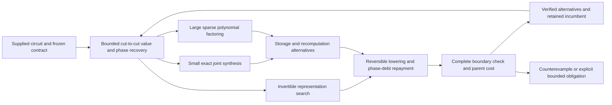

# v0.5: automatic structural candidate discovery

Version 0.5.0 can propose and check replacements autonomously on bounded
regions. The [submitted-file transfer sweep](../benchmarks/v05-transfer/README.md)
and the generated comparisons below report distinct workloads. Source hashes
and boundary promises accompany the transfer results.

The user supplies circuit bytes, actual clean/private boundary promises, an
objective and budgets. Strata recovers equations, proposes alternative
implementations, lowers them, checks the complete boundary and retains the best
verified candidate. The user does not have to supply a replacement or name the
winning mechanism. Agents extend the search language and investigate bounded
cases; they are not required to enumerate every supported candidate.



## First runnable path

```sh
strata search episode.kmb --out work/search \
  --clean-inputs 6,7,8,9 --cost 'Q*toffoli' \
  --rounds 2 --max-candidates 24 --max-operations 10000
```

Those wire IDs are illustrative: declare only the supplied circuit's guaranteed
zero inputs. Omitted wires remain arbitrary. No default zero-workspace promise
is inferred from high wire numbers. Existing classical outputs remain public
unless explicitly listed in `--internal-bits`.

`search` retains a cheaper verified candidate when its receipt identifies a
structural change. A witness can show a retired intermediate bank, an inferred
consumer equivalence class, a cheaper input or output encoding with both
conversions priced, an eliminated phase word, or a factored observable that
beats its direct implementation. A subsequent verified improvement can inherit
its parent's qualification. Inspect `structural_gains` for the witness on
each step. The broader `restructure` command also searches learned templates,
local measured lookups and tensor constructors.

For a recovered nonzero sign, the search tries observable synthesis first.
With fewer than five attempts left, it gives priority to output encodings for
multiple nonlinear outputs, or functional decomposition for a single output
of degree above two. This ordering is a heuristic and its budget matters.

For a long circuit, Strata retrieves up to eight bounded compute/restore episodes and exact
semantic regions automatically. Retrieval anchors are hypotheses, not proof of
cleanliness or inverse behavior. `--range START:STOP --range-unit operation` can
select a specific complete episode. Prefix zero facts are transported
conservatively; the candidate is priced after insertion into the complete
parent, preserving surrounding work. Sibling improvements are alternatives,
not automatically composable wins. Run again on the retained bytes to compose.

### Lookup search and solver limits

Use `--max-and` and `--joint-timeout` to change the exact joint solver's AND
and time limits. Without an explicit solver timeout, a bounded constructor
uses 80% of its current wall allowance for that solver. Unbounded SDK calls
retain the one-second default. `--joint-max-states` and
`--joint-max-expansions` control the two remaining solver caps. Each solver
receipt records the effective limits and its stopping reason.

On a complete declared promise, search tries interpolation, cofactor
completion, shared Boolean graphs, reversible output encodings and bounded
exact synthesis on care rows. Formulations that cannot fit the input or
state budgets record a reason. All candidates retain the same declared
domain. [Promised domains](PROMISED-DOMAINS.md)

A measured lookup can supply a pure proposal model when a clean AND
is erased with HMR and its outcome controls a matching CZ phase repair.
The proof covers public outputs and phase for all formal outcomes.
Use `--internal-bits` to declare private artifact outputs. At an interior
cut, an unconditional suffix overwrite before any read can independently
establish that a local measurement outcome is private at the cut.
The source cost in `discovery_yield.constructor_comparison` always refers to
the artifact supplied by the caller. The terminal lookup constructor retains
shared cache products and prices direct terminal XOR updates on dirty targets.

On long circuits, look for `complete_product_lifetime` and
`commuting_product_lifetime` in the retrieval report. These entries record
the computed wire, control wires, consumer positions and cleanup position.
The commutation check allows independent accesses and commuting target XORs
while preserving measurement order. A consumer with a dependency on an
intervening write or read can block localization. Overlong or unproved
localizations fall back to bounded contiguous regions.

## Measuring discovery yield

The research target for v0.5 is a thousandfold increase in useful structural
candidates. Its achievement is open. Use independently frozen sources and a
matched search budget. Start with the number of new cases solved and the
strength of each best result. A case with zero prior discoveries gets an
absolute count. Report both versions' numerators and denominators before
describing an improvement as a multiple.
Evaluate it on frozen problems using four numbers: cases where this build beats
the previous best, distinct verified cheaper native designs, distinct resource
tradeoffs, and improvement in the best cost. Break the results down by
mechanism and report the counts when the comparison build finds zero. A
thousand tested representations and a thousand verified improvements answer
different questions.

In a prospective experiment, a reviewer froze three untagged sources before
the wide portfolio saw them. Each engine received the same problem contracts.
The reviewer extracted retained native candidates and independently replayed
them on all inputs under those contracts.

| Build | Cheaper verified programs across three sources | Classified sets of paid functions across sources | Best costs on shared selector, mixed selector, alias control |
|---|---:|---:|---|
| v0.4.2 | 1 | 1 | 156, 156, 5 |
| v0.5 development before wide search | 35 | 17 | 70, 156, 5 |
| v0.5 first wide-search snapshot | 57 | 28 | 70, 156, 5 |
| Packaged v0.5 development recheck | 54 | 27 | 70, 156, 5 |
| v0.5.0 release wheel | 57 | 28 | 70, 156, 5 |

The shared selector gained a 9-qubit, 8-Toffoli alternative. The lowest
scalar cost on that problem remained 70. On the alias control, twelve cheaper
verified programs used just one set of paid functions. These are small,
generated fixtures. Program counts include independently verified retained
alternatives and can exceed the engine's count of structurally qualified
finalists. [Source contracts](../benchmarks/v05-holdout/yield_fresh/freeze.json)
and [candidate-by-candidate evidence](../benchmarks/v05-holdout/yield_fresh/candidate-yield.json).
The [packaged recheck](../benchmarks/v05-holdout/yield_fresh/packaged-recheck.json)
retained three fewer verified cheaper programs on the shared selector.
The search has work and wall-clock limits, and counts here describe individual
runs. All three best costs reproduced. The [release-wheel replay](../benchmarks/v05-holdout/yield_fresh/v050-release-recheck.json)
independently verified 45 cheaper programs on the first fixture and 12 on the
third. Only the first fixture improved on the v0.4.2 best.

`restructure.json` includes a `discovery_yield` record. Whole-boundary search
deduplicates verified programs across constructors, ignoring display metadata
and renaming fresh private measurement bits. It reports the number of distinct
costs, qualifying mechanisms and Pareto resource points. Two different native
schedules can implement the same mathematical idea. A region search separately
reports the complete parent splices that it actually verified.

On unmeasured Boolean/sign boundaries with up to ten active arbitrary inputs,
the receipt also groups cheaper designs by the set of paid intermediate
functions evaluated in the original input coordinates. Reordering products,
changing a helper's name or paying to evaluate the same function again leaves
this count unchanged. Circuits outside the classifier limits are reported
separately. This grouping can merge different reversible schedules.

On compatible multi-output boundaries, `architecture_portfolio` changes the
input and output bases together and refactors all consumer equations in each
representation. `--max-architectures` sets an upper bound of 1,024 distinct
formulations by default. It deduplicates mathematical graphs, rejects
unlowerable layouts, reserves a no-encoding control and chooses finalists from
multiple representations. It charges both pairs of adapters before assigning a
structural gain. The receipt separates proposed orders, unique formulations,
verified native programs and qualifying gains. The gate savings from changing
both bases can be compared with input-only and output-only controls.

For an in-place boundary whose outputs depend on modified targets, the search
also attempts to recover its invertible affine part. It factors the affine
map from either side, synthesizes a compatible nonlinear remainder, and emits
the recovered map with its complete native cost. Singular affine parts and
remainders outside this model produce explicit rejection receipts.

The CLI defaults to collecting discoveries. Use `--max-finalists` to set the
budget for separately checking additional qualifying alternatives returned by
a constructor. `--goal best-cost` also lets the search stop after reaching a
known zero bound on a supported nonnegative objective. In discovery mode it
can still retain other cheaper-than-source designs.

Before running a constructor, the CLI checks necessary conditions inferred
from exact value and phase equations. The consumer-decomposition search also
uses bit-parallel probes: three distinct consumer responses rule out a one-bit
interface for that partition. Survivors get a complete symbolic check. Proofs
of identical native candidates can be reused for the same parent and privacy
contract. Failed probes and timed-out trials do not become impossibility claims.

On Linux, `--trial-seconds` limits an isolated constructor and `--seconds`
sets its shared search budget. Creating `OUT/STOP` cancels an active
constructor and prevents new trials. Strata returns its best accepted circuit
and its receipts. Initial parsing, parent verification and final report
serialization can extend elapsed time beyond the constructor budget.
Choose a fresh output directory to start another run.

## Layer 1: recover the mathematical boundary

Supported instructions are propagated as exact Boolean values and sign phase.
Sparse ANFs are used where affordable; canonical decision diagrams avoid
expanding every intermediate expression and can project only final values.
An HMR introduces an explicit outcome variable and phase contribution. A reset
is accepted only when its active target is proved zero. Unsupported instructions,
excessive degree/graph size produce a bounded or opaque receipt; they never
produce a truncated equation presented as exact. A nonzero phase can have an
exact receipt while still blocking a constructor that requires zero phase.

All modified outputs are synthesized together. For a restored producer bank
`P`, a consumer `L(P)` and its cleanup, the searched specification is the final
consumer map. The original internal bank need not survive the new implementation.
Dirty output accumulators remain arbitrary and are updated by XOR.

The value constructors accept preserved inputs and Boolean XOR accumulators with
zero phase. The observable constructor accepts a restored value map and an
exact Boolean sign. A separate [fractional-phase constructor](FRACTIONAL-OBSERVABLES.md)
builds native dyadic endpoint phases for unconditional reversible circuits.
[Promised-domain discovery](PROMISED-DOMAINS.md) specializes a supplied boundary
to a complete explicit or compact domain. Bind an interior promise to the cut
before using it on an extracted episode.
The exact joint path defaults to at most eight supporting inputs, three AND
nodes and one second of search; the symbolic algebraic path avoids that input
table cap but still has explicit term, graph, operation and time budgets.
It does not automatically infer a complete field, integer division, interpolation
or approximate numeric contract from arbitrary bytes. Word-level recognizers
must subsequently prove their interpretation, including field polynomial,
endianness, overflow, zero branches and restoration. This remains part of #9.

Don't-cares require a domain or observable proof. A finite complete domain can
justify values outside that domain being irrelevant; sampled boundary
observations cannot. A small vector coefficient is not zero amplitude. Phase
periodicity does not make an arbitrary high phase bit irrelevant: exact modular
semantics and the complete error budget must justify the omission. Current
automatic whole-function construction uses all public inputs; the new reachable
observation and floor APIs do not silently weaken its contract.

## Layer 2: search functions, representations and schedules

**Inferring a producer from its consumer.** For a proposed group of input
bits A, substitute every assignment of A into every output equation and keep
the remaining inputs symbolic. If two assignments leave identical residual
polynomials across *every* output, no downstream output can distinguish them.
If there are precisely two distinct residual vectors, one inferred bit h(A)
identifies the class. Synthesize the whole map as
`F0 XOR h(A)*(F0 XOR F1)`. The original inputs stay live where the boundary
requires restoration. Recovered class bits compete against other constructions
after lowering. Group sizes currently range from two to four; at most 96 groups
are tried by default. This is a bounded application of Ashenhurst–Curtis
functional decomposition. [Practical Boolean Decomposition](https://arxiv.org/abs/2406.06241)

**Searching the output representation.** Row XORs between dirty accumulators
can expose sharing between several output deltas. With an invertible output
basis E, implement `y → E*y → E*y XOR E*F(x) → y XOR F(x)`.
A nonidentity basis earns a witness when it beats the completed unencoded
factorization comparison and the supplied circuit under the same objective.
The receipt includes both conversions and the restored ordered named registers.

**Synthesizing the observable directly.** On a region that restores all
quantum values, the sign itself can be the complete function of interest.
Strata factors that polynomial, emits the phase into a reversible parity
basis and restores that basis. It separately prices the direct monomial
construction where available. A development fixture with 27 cubic sign terms
factored into a product of three parities, implemented with one CCZ.

1. **Bounded exact joint XOR/AND synthesis.** Small maps enter a finite search
   over linear spans and product nodes. Outputs share intermediate products.
   Constant and XOR operations are free only in this mathematical AND-count
   model; emitted native operations are all counted. Exhausted lower levels can
   establish a minimum within this model. Timeout is unknown. This is currently
   an exact enumerator, not an integrated general-purpose SAT solver.
2. **Algebraic construction without truth-table enumeration.** Larger sparse
   output polynomials use bounded Shannon/cofactor factorizations
   `F = L*A XOR B`. Variables sharing a residual are grouped into `L`; canonical
   polynomial subexpressions are shared across outputs. Several deterministic
   variable/output orders produce competing product DAGs. An independent
   polynomial replay and complete-boundary check validate each emitted result.
   This is a constructive heuristic, not a minimum-rank certificate.
3. **Executable representation search.** Cofactors and dependencies propose
   bounded invertible Boolean affine encodings. For an input-preserving source
   `F`, the transformed body is synthesized in the encoded representation, then
   wrapped in its encoder and inverse. Those conversions, intermediate gates
   and cleanup are included in the full parent cost. The initial implementation
   supports X/CX affine encodings; integer offsets, field towers and projective
   coordinates are future typed operators, not implemented capabilities.
4. **Reversible scheduling.** A bounded Pareto search chooses compute, consume,
   uncompute and recompute actions for the joint DAG, including transient
   workspace and asymmetric forward/return costs. Native lowering and replay
   determine which mathematical schedules actually fit the declared wires.
   A floor for this DAG is not a floor for all circuits implementing the function.

The schedule/measurement lowerer accepts both the small exact graph and the
larger symbolic algebraic graph. The latter is independently replayed as
polynomials against the source boundary; it does not fabricate a truth table or
an exact-minimum receipt. Affine-representation candidates still use their own
pure reversible lowering; their encoded internal DAGs are not yet fed directly
to this shared scheduler.

The exact objective evaluates emitted whole-parent resources. A marginal
qubit/Toffoli exchange rate may rank proposals but cannot override the formula
or introduce a clean helper. A failed priced construction does not close its
mathematical family. Some inner searches return only their best complete
candidate to the outer beam; retaining every temporarily expensive intermediate
representation is not yet implemented. `--accounting expected` uses the explicitly
declared classical distribution; unknown probabilities stay unknown. See
[measurement accounting](V0.5-MEASUREMENTS.md).

The advice to use tensor decompositions is useful, with a mathematical caveat:
real-valued alternating least squares is not an exact solver over a finite
field. Any such proposal must be reduced to the declared field and replayed
exactly. Bilinear-rank bounds also do not bound unrestricted nonlinear XAGs.
The existing tensor path remains separately scoped; it does not justify calling
every table/interpolation composition bilinear.

## Layer 3: lower with explicit debts

Terminal products can update dirty outputs directly. Only products needed by
later products require stored workspace. The standard path reverses all stored
computations. The measured path can erase a proved product and rebuild its
affine operand basis for the matching conditional phase correction, restoring
that basis afterward. If those operands are unavailable, the lowerer must use a
different schedule or retain the pure uncompute alternative.

Fresh compiler measurement bits are allocated above the complete parent's
classical namespace. Existing bits never become private merely because hiding
them makes a candidate pass. Outcome-independent public value and sign maps
can be compared without equating private measurement histories. More general
outcome-dependent instrument equivalence remains unsupported. Local episodes
cannot hide a bit that surrounding code consumes.

The lab can prove all formal outcomes with bounded decision diagrams per input,
including nonlinear controls and exact dyadic phases. This avoids explicitly
enumerating an exponential number of branches when the symbolic function stays
compact. Node explosion is still possible. Actual native executions, symbolic
inputs and represented branches are reported separately.

A future full CEGIS solver must use each failing input/outcome as a hard
constraint in the same frozen candidate grammar. Current constructors replay
complete functions, reject failed proposals and retain counterexamples; they do
not yet implement a general solver that repairs arbitrary algebraic programs
from those counterexamples. Do not relabel rejection logging as CEGIS learning.

## Evidence and release gates

The [frozen generated benchmark](../benchmarks/v05-structural/README.md) compares
unchanged source fixtures with the published v0.4.2 implementation. Count
qualified structural wins, native independent correctness, complete objective
changes, refusals, actual time and peak memory separately. Equal ceilings do
not mean equal CPU consumption. Development fixtures are not blind historical
discovery evidence.

Two additional algebraic scale regressions exercise 12 and 24 inputs without
truth tables. They establish supported symbolic scaling, not a contest gain.
Real small-decoder checks also expose limits: the GF(4) BM fixture with four
syndrome symbols passes all256 inputs and all2^72 formal outcome assignments,
with native branch-zero cross-checks; the existing inverse fixture
still reaches a decision-node bound on nonzero inputs. A larger BM variant has
a native-confirmed scratch leak. Neither failure is converted to a passing
receipt by relaxing its contract.

Before claiming broad v0.5 discovery acceptance:

- Freeze independent held-out modular arithmetic, polynomial-evaluator and
  differential-table generators and seeds, strip tags, and prohibit move hints.
- Include phase faults, dirty outputs, sparse wire IDs, zero branches, arithmetic
  singularities and boundary adaptations in mutation checks.
- Compare released v0.4.2 and v0.5 under the same explicit ceilings, recording
  actual resources and the baseline's missing capabilities.
- Require improvements beyond isolated one-gate changes on multiple families,
  retain every failure, and verify the emitted complete boundary independently.
- Bind receipts to final implementation bytes and test the installed wheel.
- Keep host contract-tree recovery, full historical discovery and real official
  score improvements explicitly unmet until their own acceptance tests pass.

There is no general promise of finding the globally cheapest equivalent quantum
circuit. Reports must distinguish **best verified candidate**, **exhausted
bounded search**, and **proved optimum in a named restricted model**.

## Research informing the design

- [Xor-And-Inverter Graphs for Quantum Compilation](https://www.nature.com/articles/s41534-021-00514-y)
  motivates synthesizing a shared Boolean function graph and then planning
  reversible computation. Strata additionally prices the complete parent.
- [Reqomp](https://arxiv.org/abs/2212.10395) motivates explicit qubit/gate tradeoffs
  in automatic uncomputation; it does not make every source schedule optimal.
- [Temporary logical ANDs](https://arxiv.org/abs/1709.06648) motivates measured
  cleanup under a proved product identity and matching correction.
- [Modular synthesis of uncomputation](https://arxiv.org/abs/2406.14227) motivates
  an IR that represents dependencies and restoration rather than relying on
  gate adjacency.
- [egg](https://arxiv.org/abs/2004.03082) is relevant to retaining equivalent
  representations. An e-graph alone does not invent transformations absent
  from its language, and scalar extraction costs miss shared storage effects.
- [CEGIS analysis](https://arxiv.org/abs/1407.5397) motivates finite grammars and
  explicit counterexamples. A bounded unsuccessful run is not impossibility.

These are design influences; the current implementation does not incorporate
the cited tools or inherit their benchmarks or guarantees.
